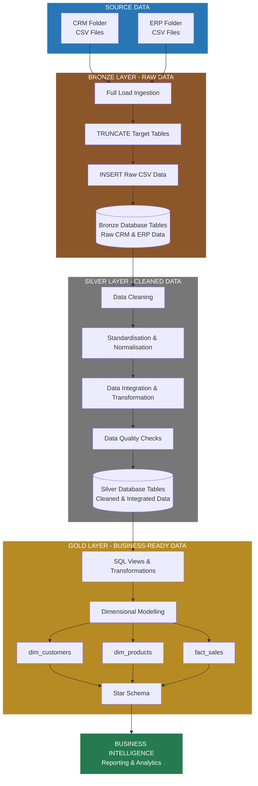

# SQL Data Warehouse Project 🏗️

## 📖 Project Overview
This project demonstrates the design and implementation of a modern data warehouse using SQL. It focuses on building a structured data pipeline that extracts raw data from CRM and ERP source systems, transforms it into clean and integrated datasets, and models it for analytical purposes. 


## 🎯 Project Objectives
*   **Data Ingestion:** Extract and load raw data from CRM and ERP systems into the Bronze layer.
*   **Data Transformation:** Clean, standardize, and normalize data in the Silver layer (handling missing values, standardizing country codes, and resolving gender conflicts).
*   **Data Modeling:** Implement a dimensional **Star Schema** in the Gold layer for analytical reporting.
*   **Business Value:** Create business-ready fact and dimension views to answer key questions like "Which products generate the highest revenue?" and "Which countries have the highest sales?"

## 🏗️ Architecture & Data Flow

The project follows the **Medallion Architecture (Bronze, Silver, Gold)** to ensure data quality, consistency, and business readiness.


## End-to-End Data Architecture

The following diagram illustrates the flow of data from CRM and ERP CSV source files through the Bronze, Silver and Gold layers, ultimately producing business-ready datasets for analytics and reporting.


 

## The Project Layers Roles:

1.  **🥉 Bronze Layer (Raw Data):** Stores raw data ingested from source systems with minimal transformation.
2.  **🥈 Silver Layer (Cleaned Data):** Responsible for data cleaning, standardization, and integration. (e.g., removing hyphens from customer IDs, standardizing country names like 'DE' to 'Germany', and handling NULLs).
3.  **🥇 Gold Layer (Business Consumption Ready):** Contains the dimensional model, organized into a Star Schema consisting of Dimensions and Facts.


## 📊 Data Model (Gold Layer)

The Gold Layer represents the final stage of the Medallion Architecture, where cleaned and integrated data from the Silver Layer is transformed into analytical datasets red for business use.

It consists of three primary SQL views designed using **Dimensional Modelling** and organised into a **Star Schema**.

### ⭐ Dimension Views

- **`gold.dim_customers`**: Integrates customer information from CRM and ERP sources, combining customer attributes, demographic information, and location details. Generates a unique surrogate key (`customer_key`) using `ROW_NUMBER()` and applies business rules to resolve conflicting gender information between source systems.

- **`gold.dim_products`**: Combines CRM product information with ERP product category data to create a comprehensive product dimension. Generates a unique surrogate key (`product_key`) and filters out historical product records using `WHERE prd_end_dt IS NULL`, ensuring that only currently active products are included.

### 📈 Fact View

- **`gold.fact_sales`**: Serves as the central fact view, containing sales transaction data sourced from the Silver Layer. It connects sales records to the customer and product dimensions through their respective surrogate keys (`customer_key` and `product_key`). It includes key transactional attributes such as order details, dates, sales amounts, quantities, and prices.

### 🔗 Star Schema Design

The Gold Layer follows a Star Schema design, with `fact_sales` at the centre, connected to `dim_customers` and `dim_products`.

This structure separates measurable business events (sales transactions) from descriptive business entities (customers and products), making analytical queries more organised and easier to maintain.

The resulting data model provides a business-ready foundation for:

- Analysing sales performance across customers and products.
- Aggregating sales amounts and quantities.
- Exploring customer and product attributes.
- Building Business Intelligence reports and dashboards.
- Supporting data-driven business decisions.

### 🗺️ Data Model Diagram


      
## 🛠️ Tech Stack & Tools

| Category | Technology |
| :--- | :--- |
| **Language** |  |
| **Database** |  |
| **IDE / Tool** |  |
| **Version Control** |   |


## 📂 Project Structure

```text
├── datasets/                  # Raw source data (CSV files)
│   ├── crm/                   # 3 CRM datasets (Customer Info, Product Info, Sales Details)
│   └── erp/                   # 3 ERP datasets (Customer AZ12, Location A101, Category G1V2)
├── scripts/
│   ├── bronze/                # DDL and ingestion scripts
│   ├── silver/                # Data cleaning and transformation scripts
│   └── gold/                  # Data modeling (Views creation)
└── README.md                  # Project documentation
